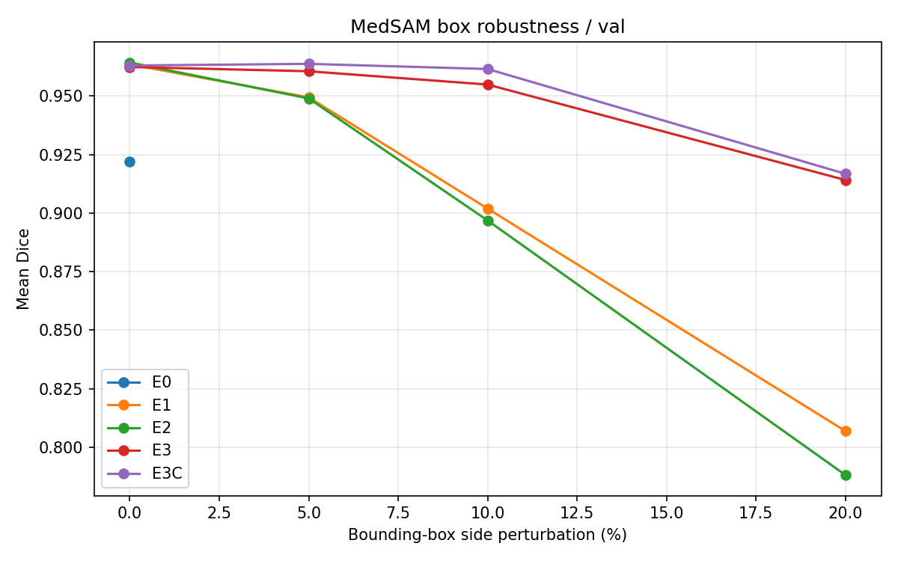
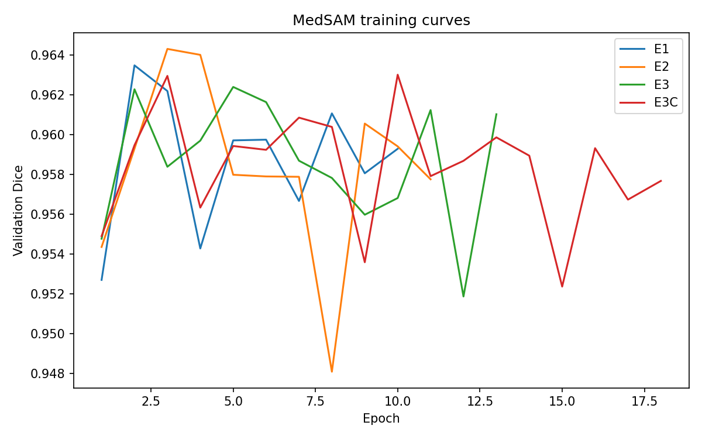
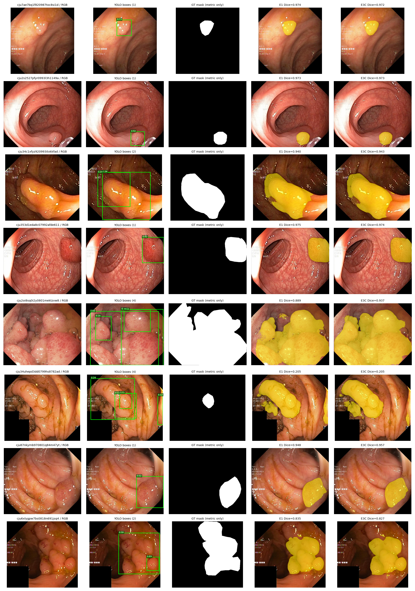
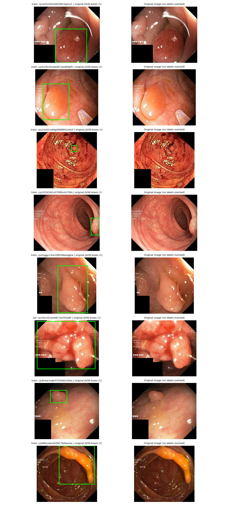

# MedSAM + Kvasir-SEG：单卡 RTX 2080 Ti 22GB 的息肉分割全流程实验

在 **RTX 2080 Ti 22GB / PyTorch 2.1.0 / CUDA 12.1** 上，用官方 **MedSAM ViT-B** 只微调 Mask Decoder，
系统比较 5 种解码器方案在两种提示来源下的表现：

1. **Oracle Box**：由 GT 掩码导出的理想框（条件分割，用于比较解码器本身）；
2. **自动框**：YOLOv8n 检测器预测的框（无人工提示的端到端流程）。

全部代码按编号脚本组织（`00` → `12`），每步产出可核对的 `report.json` / `summary.json` / CSV / 图，
并且**默认拒绝覆盖已有结果**，保证实验链条可追溯。

---

## 主要结论

| # | 结论 | 关键数字 |
|---|---|---|
| 1 | 仅微调 Mask Decoder 就显著超过官方预训练 MedSAM | val Dice **0.9219 (E0) → 0.9635 (E1)** |
| 2 | 双提示方案对框扰动几乎免疫 | 20% 框扰动下 val Dice：E1 **0.8069**、E3 **0.9141**、E3C **0.9168** |
| 3 | 收益主要来自"双提示"，一致性损失本身贡献很小 | E3C（无一致性损失）≈ E3；E3C vs E3 在 0% 扰动 Dice 差 **+0.0006**，CI 含 0 |
| 4 | 换成 YOLOv8n 自动框后端到端仍可用，但明显低于 Oracle 框 | test Dice：回转 **0.8897 / 0.8916**（E1/E3C）vs Oracle **0.9697 / 0.9686** |
| 5 | 自动框模式下 E3C 与 E1 的差异不显著 | test Dice 差 **+0.0019**，95% 图像级 CI **[−0.0044, +0.0076]** |

> 结论 4/5 的退化主要不是分割问题：多框图像（20/100）现有解码器只能对每个框各出一次 mask 再并集，
> 该子集 Dice 只有 **0.689 (E1) / 0.685 (E3C)**，把整体均值拉低；单框子集（80/100）仍为 **0.940 / 0.943**。

---

## 1. 实验设计

| 实验 | 训练内容 | 描述 |
|---|---|---|
| **E0** | 不训练 | 官方 `medsam_vit_b.pth` 直接推理，作为基线 |
| **E1** | Mask Decoder | Dice + BCE，框向外随机扩大 ≤20（1024 坐标像素） |
| **E2** | Mask Decoder | E1 + 边缘带加权 BCE（`boundary_lambda=0.2`，带宽 5 px） |
| **E3** | Mask Decoder | 同一编码器特征 + 两个有偏框，共享解码器，加 mask 一致性损失 |
| **E3C** | Mask Decoder | **E3 的两提示结构，但 `consistency_lambda=0`**，用来把"双提示"与"一致性损失"分开 |
| **E4** | — | E2 + E3 组合。**代码已支持但本机未训练**（配置保留，见 `04_train.py`） |

ViT-B 图像编码器全程冻结，特征在 Step 02 一次性缓存（FP16，`256×64×64`，每张约 2 MiB），
所以每个 epoch 只需要解码器前向 + 反传，一张 22GB 卡足够 batch=4。

数据划分：Kvasir-SEG 1000 对图像，`seed=42` 图像级随机 **800 / 100 / 100**。
这是**自定义图像级划分**，不是某论文的官方划分，也**不是患者级划分**（原始数据未提供患者 ID）。

---

## 2. 结果

### 2.1 Oracle Box 分割（val，100 图）

| 实验 | Dice | IoU |
|---|---|---|
| E0（官方权重） | 0.9219 | 0.8800 |
| E1 | **0.9635** | 0.9332 |
| E2 | **0.9643** | **0.9352** |
| E3 | 0.9624 | 0.9311 |
| E3C | 0.9630 | 0.9329 |
| E4 | 未训练 | — |

### 2.2 框扰动鲁棒性（val，每档 3 次扰动，图级别平均）

| 实验 | 0% | 5% | 10% | 20% |
|---|---|---|---|---|
| E0 | 0.9219 | — | — | — |
| E1 | 0.9635 | 0.9494 | 0.9019 | 0.8069 |
| E2 | 0.9643 | 0.9490 | 0.8968 | 0.7881 |
| E3 | 0.9624 | 0.9606 | 0.9549 | 0.9141 |
| E3C | 0.9630 | **0.9637** | **0.9615** | **0.9168** |



### 2.3 图像级配对 Bootstrap（val，5000 次重采样）

| 对比 | 0% Dice 差 [95% CI] | 5% Dice 差 [95% CI] |
|---|---|---|
| E3C − E1 | −0.00047 [−0.0041, +0.0036] | **+0.01431 [+0.0084, +0.0213]** |
| E3 − E1 | −0.00108 [−0.0072, +0.0056] | **+0.01115 [+0.0039, +0.0192]** |
| E3C − E3 | +0.00061 [−0.0058, +0.0063] | +0.00316 [−0.0022, +0.0086] |

理想框下三者无显著差异；扰动越大，双提示方案的优势越显著，而**去掉一致性损失几乎不影响结果**。
完整表格见 `docs/results/paired_*_val.csv`，训练曲线见下：



### 2.4 自动检测框（YOLOv8n → MedSAM）

检测器：YOLOv8n，`epochs=80 / batch=8 / imgsz=640 / patience=15 / seed=42`，实际 **46 epoch 早停**（best 在 epoch 31）。

| 检测指标（val） | Precision | Recall | mAP50 | mAP50-95 |
|---|---|---|---|---|
| best.pt 复核 | 0.867 | 0.853 | 0.902 | 0.669 |

置信度阈值**只在 val 上选**（test 全程锁定）：

| conf | 预测框 | 零检出图像 | E1 Dice | E3C Dice |
|---|---|---|---|---|
| 0.10 | 126 | 2 | 0.8631 | 0.8675 |
| 0.15 | 114 | 3 | 0.8530 | 0.8579 |
| 0.25 | 102 | 8 | 0.8429 | 0.8488 |

据此固定 `conf=0.10`，之后**只跑一次 test**：

| test（conf=0.10，127 框，零检出 0，多框 20） | Dice | IoU | Boundary F1 (2px) | HD95 (px) |
|---|---|---|---|---|
| E1 | 0.8897 | 0.8322 | 0.6259 | 57.70 |
| E3C | **0.8916** | **0.8375** | **0.6375** | **56.92** |

配对 Bootstrap：Dice 差 **+0.0019**，95% CI **[−0.0044, +0.0076]** → 不显著。
单框子集（n=80）0.9398 → 0.9433；多框子集（n=20）0.6893 → 0.6849。



YOLO 标签抽样（来自官方 bbox JSON，非从掩码反推）：



> 完整数值：`docs/results/`；逐图明细与图在运行时写入 `outputs/`（已 gitignore）。

---

## 3. 目录结构

```
medsam_2080ti_stepwise/
├── config.example.yaml            # 配置模板；复制为 config.yaml 后使用（config.yaml 不入库）
├── requirements.txt
├── core/                          # 全部脚本共用的实现
│   ├── seg.py                     # MedSAM 预处理、框几何、指标（Dice/IoU/BoundaryF1/HD95）、损失
│   ├── evaluate.py                # 唯一的推理评估协议（E0/E1-E4 与鲁棒性共用）
│   ├── data.py                    # 特征缓存 Dataset（解码器微调用）
│   └── utils.py                   # 配置解析、路径、JSON/CSV、GPU 检查
├── tests/                         # 纯 CPU 单元测试（7 项）
├── docs/
│   ├── figures/                   # README 引用的小图
│   └── results/                   # 结果 CSV/JSON 快照（可离线核对）
├── 00_preflight.py                # 环境检查 + 资产搜索 + 自动回填 config
├── 01_prepare.py                  # 配对校验、掩码/框统计、固定 800/100/100 划分
├── 02_cache.py                    # 冻结 ViT-B 的 FP16 特征缓存（可断点续跑）
├── 03_evaluate.py                 # 单实验评估（Oracle Box，支持框扰动）
├── 04_train.py                    # 解码器微调 E1/E2/E3/E3C/E4
├── 05_report.py                   # 汇总曲线：鲁棒性 + 训练过程
├── 06_robustness.py               # 批量跑 0/5/10/20% 扰动
├── 07_paired_robustness_analysis.py   # E1 vs E3 配对 Bootstrap（图像级）
├── 08_compare_models_bootstrap.py     # 任意两实验配对 Bootstrap
├── 09_prepare_yolo_from_json.py   # 用官方 bbox JSON 生成 YOLO train/val 标签
├── 10_train_yolo.py               # YOLOv8n 训练（只读 train/val）
├── 11_yolo_medsam_validate.py     # YOLO 预测框 → MedSAM E1/E3C 端到端评估
└── 12_auto_yolo_paired_analysis.py# 自动框模式下 E3C vs E1 配对 Bootstrap
```

---

## 4. 环境

| 项 | 版本 |
|---|---|
| GPU | NVIDIA RTX 2080 Ti 22GB（sm_75） |
| Python | 3.10.13 |
| PyTorch / torchvision | 2.1.0+cu121 / 0.16.0 |
| NumPy | **1.26.4（必须 <2）** |
| Ultralytics | 8.4.x（仅 Step 09-12 需要） |

```bash
# 1) torch 请按你的 CUDA 版本装（本实验为 cu121），不要用 requirements.txt 覆盖
# 2) 其余依赖
python -m pip install -r requirements.txt
# 3) ultralytics 建议 --no-deps，避免它把 opencv-python 升到 5.x 从而强制 numpy>=2
pip install "ultralytics>=8.0,<9" --no-deps
```

---

## 5. 快速开始

```bash
cp config.example.yaml config.yaml      # 首次运行会自动创建，也可手动复制
python -m unittest discover -s tests -v # 7 项 CPU 测试
```

### 阶段 A：Oracle Box 分割实验

```bash
# 00 环境与路径（只有一个候选时会自动写回 config.yaml）
python 00_preflight.py --scan-root /path/to/data-root

# 01 数据校验 + 固定划分；务必人眼看 outputs/01_data/samples.png
python 01_prepare.py

# 02 冻结 ViT-B 特征缓存（1000 张约 2GB，可断点续跑）
python 02_cache.py

# 03 E0 基线
python 03_evaluate.py --exp E0 --split val

# 04 训练解码器（每次一个实验）
python 04_train.py --exp E1
python 04_train.py --exp E2
python 04_train.py --exp E3
python 04_train.py --exp E3C
# 中断后续训：python 04_train.py --exp E1 --resume

# 03 评估各实验
python 03_evaluate.py --exp E1  --split val
python 03_evaluate.py --exp E2  --split val
python 03_evaluate.py --exp E3  --split val
python 03_evaluate.py --exp E3C --split val

# 05 + 06 鲁棒性曲线（0/5/10/20%，每档 3 次）
python 06_robustness.py --experiments E0 E1 E2 E3 E3C --split val --trials 3
python 05_report.py --split val

# 07/08 配对 Bootstrap（不需要 GPU）
python 08_compare_models_bootstrap.py --split val --baseline E1 --candidate E3C --bootstrap 5000
python 07_paired_robustness_analysis.py --split val --bootstrap 5000
```

### 阶段 B：自动检测框端到端

```bash
# 09 官方 bbox JSON → YOLO 标签（test 不写标签）
python 09_prepare_yolo_from_json.py --bbox-json /path/to/kavsir_bboxes.json

# 10 训练检测器
python 10_train_yolo.py --weights yolov8n.pt --epochs 80 --batch 8 --imgsz 640 \
    --patience 15 --seed 42 --workers 2

# 11 在 val 上扫阈值（只决定 conf），再在 test 上跑一次
python 11_yolo_medsam_validate.py --split val  --conf 0.25
python 11_yolo_medsam_validate.py --split val  --conf 0.15
python 11_yolo_medsam_validate.py --split val  --conf 0.10
python 11_yolo_medsam_validate.py --split test --conf 0.10 --final-test

# 12 自动框模式的配对分析
python 12_auto_yolo_paired_analysis.py --split test --conf 0.10 --bootstrap 5000
```

### 阶段 C：最终测试（只在方案冻结后执行一次）

```bash
python 03_evaluate.py --exp E1  --split test --final-test
python 03_evaluate.py --exp E3C --split test --final-test
python 06_robustness.py --experiments E1 E3C --split test --trials 3 --final-test
```

> `--split test` 不带 `--final-test` 会直接报错退出，避免反复用测试集调参。

**所有命令都在项目根目录执行**（`07/08/12` 的 `--work` 默认是相对路径 `outputs`）。

---

## 6. 指标口径

- **Dice / IoU**：先在**原图分辨率**得到二值 mask，再逐图计算、最后对图像求平均（不是把 1024 掩码降采样后算）。
- **Boundary F1**：边界容差固定为**原图 2 像素**。
- **HD95**：原图像素单位的对称边界距离 95 分位；空预测按图像对角线长度惩罚。
- **Bootstrap**：以**图像**为重采样单位（同一张图的 3 次扰动先取均值，避免伪重复），5000 次重采样，百分位法 95% CI。
- **置信区间含义**：只反映"固定模型 + 固定扰动采样"下的图像抽样不确定性，**不能替代跨训练种子的稳定性验证**。

---

## 7. 工程约束（有意为之）

| 约束 | 位置 | 原因 |
|---|---|---|
| 划分不可变 | `01_prepare.py` | 已有 `splits.json` 与当前数据/种子不符时拒绝覆盖 |
| 特征缓存校验 | `02_cache.py` / `core/seg.py` | 缓存里记录 `split_hash` + 权重 hash，换权重/换划分必须 `--reset` |
| 训练不覆盖 | `04_train.py` / `10_train_yolo.py` | `last.pth` / `run_dir` 已存在时必须显式 `--resume` 或先备份 |
| 评估不越界 | `03_evaluate.py` / `11_...` | test 需要 `--final-test`；自动框评估目录非空拒绝重跑 |
| 原子提交 | `09_prepare_yolo_from_json.py` | 先写临时目录，全部校验通过后 `rename` |
| 数值健全性 | `04_train.py` | loss 出现 NaN/Inf 立即抛错，不静默继续 |

---

## 8. 已知限制

1. **Oracle Box ≠ 全自动**。E0/E1-E4 的主表使用 GT 掩码导出的框，属条件分割；只有 `11/12` 是无人工提示的端到端结果。
2. **多框图像是主要瓶颈**：当前流程对每个框各解一次后取并集，不能区分"同一息肉被两个框重复命中"与"两个息肉"，多框子集 Dice 仅约 0.69。
3. **E4 未训练**：代码路径完整，但没有本机结果，因此不参与任何结论。
4. **划分是图像级随机**，非患者级；不同随机种子下的划分差异未做敏感性分析。
5. **Bootstrap 只覆盖图像抽样不确定性**，单次训练的模型方差未评估。
6. **AMP 在本机被 Ultralytics 自动关闭**（`check_amp` 返回 False），YOLO 以 FP32 训练；MedSAM 部分按 `config.yaml` 的 `amp: true` 走 `torch.cuda.amp`。

---

## 9. 环境陷阱（都是这台机器真实踩过的）

**① `TypeError: Object of type int64 is not JSON serializable`**
YOLO 的类别 id 是 `np.int64`，写 JSON 前需 `int()`；本仓库已在 `11_yolo_medsam_validate.py` 处理。

**② `RuntimeError: Numpy is not available` / `UserWarning: Failed to initialize NumPy`**
说明 numpy ≥ 2 与 torch 2.1.0（按 NumPy 1.x 编译）不匹配，通常是安装 `opencv-python 5.x` 带进来的：

```bash
pip uninstall -y opencv-python
pip install "opencv-python-headless>=4.8,<4.12"
pip install "numpy==1.26.4"
```

**③ `FileNotFoundError: No bbox JSON at .../kavsir_bboxes.json`**
`--bbox-json` 是相对**当前工作目录**解析的，跨目录运行请传绝对路径。文件名里的 `kavsir` 是上游原始拼写，不是笔误。

**④ AMP 自检失败**
`AMP: checks failed ... AMP will be disabled` 不是错误，Ultralytics 会退回 FP32 继续训练（只是更慢、显存更高）。

---

## 10. 数据与权重来源

- 数据集：[Kvasir-SEG](https://datasets.simula.no/kvasir-seg/)（1000 张息肉图像 + 掩码 + 官方 bbox JSON）
- 模型代码：[bowang-lab/MedSAM](https://github.com/bowang-lab/MedSAM)（`segment_anything/`）
- 预训练权重：官方 **`medsam_vit_b.pth`**（不是原始 SAM ViT-B 权重）
- 检测器：[Ultralytics YOLOv8n](https://github.com/ultralytics/ultralytics)，COCO 预训练后微调

本仓库**不包含**数据集、MedSAM 权重与任何训练得到的 checkpoint（见 `.gitignore`）。

## 11. 说明

- 代码用于方法对比与工程复现，README 中的数字都来自 `outputs/` 下真实产物（并快照到 `docs/results/`），未做任何修饰。
- 单次训练、单张 2080 Ti，结论应视为该设置下的观察，而非普适排名。
